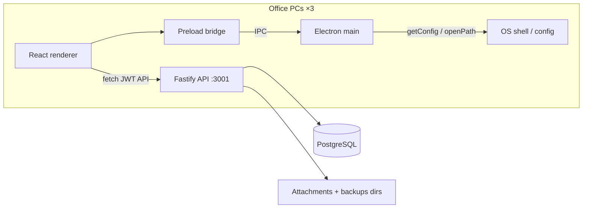
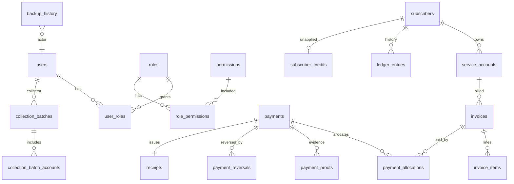

# BCIS Technical Documentation

Derived from the codebase as of the lab build. See [SPEC.md](./SPEC.md) for product requirements and [decisions.md](./decisions.md) for ADRs.

## 1. Requirements summary

- **Context:** Bukidnon Cable and Internet Services (BCIS). Up to three simultaneous Windows office PCs.
- **Architecture:** Electron clients → Fastify API → PostgreSQL. Renderer never opens a DB connection.
- **Priorities:** Financial correctness, history preservation, concurrency safety, server-side RBAC — not CRUD speed.
- **Money:** Integer centavos (`bigint`) everywhere authoritative; format to pesos only in UI/exports.
- **Mutations:** Multi-step financial posts use PostgreSQL transactions. Posted records are reversed/voided/adjusted, never silently deleted.
- **Roles:** Owner, Administrator, Cashier, Collection Supervisor, Collector, Auditor, Technician, Viewer — matrix in `packages/shared/src/permissions.ts`.

## 2. Architecture

| Layer | Location | Responsibility |
|-------|----------|----------------|
| UI | `apps/desktop/src/renderer` | Screens, forms, permission-gated nav |
| Preload | `apps/desktop/src/preload` | Narrow `window.bcis` IPC surface |
| Main | `apps/desktop/src/main` | Window, config, `shell.openPath` |
| API routes | `apps/api/src/routes` | HTTP, Zod parse, `requirePermission` |
| Services | `apps/api/src/services` | Transactions, posting, reports |
| Domain pure | `packages/shared/src/billing` | Allocation, invoice totals, ledger balances |
| Schema | `packages/db/src/schema` | Drizzle tables + migrations |

## 3. Modules

| Module | What it covers |
|--------|----------------|
| Auth / users | Login, JWT + `session_version`, lockout, user CRUD, role assign |
| Subscribers | Identity, search, status (no hard delete), options pickers |
| Plans / service accounts | Internet/Cable/Combo plans; accounts with rate snapshot; service events |
| Billing | Period generate, invoices, void/adjust, ledger + SOA |
| Payments | Post, allocate, GCash pending/verify/reject, reverse, receipts, proofs |
| Collections | Areas, batches (OPEN→CLOSED), remittance shortage/overage |
| Receivables / dashboard | Aging, overdue alerts, KPI aggregates |
| Suspensions | Suspension + reconnection workflow |
| Reports | Preview + XLSX/PDF/CSV export; route sheet |
| Backups | `pg_dump` + attachments, verify, restore with write lock |

## 4. Entity relationship (main tables)

## 5. Brief data dictionary

| Table | Purpose | Notable columns / constraints |
|-------|---------|-------------------------------|
| `users` | Staff accounts | `password_hash` (argon2), `session_version`, `locked_until` |
| `roles` / `permissions` / `role_permissions` / `user_roles` | RBAC | Permission codes e.g. `payment.create` |
| `subscribers` | Customer identity | Unique `account_number` (`SUB-######`); status ACTIVE/INACTIVE/TERMINATED/ARCHIVED |
| `service_accounts` | Billable service line | Unique `account_number` (`SVC-######`); `current_rate_centavos` snapshot |
| `service_plans` / `service_types` | Catalog | Price in centavos; plan edits do not backfill accounts |
| `billing_cycles` | Generation run per `YYYY-MM` | Status OPEN/GENERATED/CLOSED |
| `invoices` | Monthly bill | Unique `invoice_number`; partial unique `(service_account_id, billing_period)` where status ≠ VOID |
| `invoice_items` | Line items with rate snapshot | |
| `ledger_entries` | Append-only debit/credit | Running balance computed at read time |
| `subscriber_credits` | Unapplied advance per subscriber | |
| `payments` | Posted / pending / reversed | Unique `idempotency_key`; partial unique GCash `reference_number` for PENDING/VERIFIED |
| `payment_allocations` | Payment → invoice amounts | |
| `payment_proofs` | GCash proof files | Safe stored filename under attachments dir |
| `payment_reversals` | Linked reversal record | Reason + actor required |
| `receipts` | Unique `receipt_number` (`RCPT-######`) | VOID keeps number reserved |
| `collection_batches` / `collection_batch_accounts` | House-to-house batch | States OPEN…CLOSED; remittance difference + `shortage_reason` |
| `collection_areas` | Geographic routes | |
| `account_sequences` | Locked counters | Prefixes SUB, SVC, INV, RCPT, BATCH |
| `audit_logs` | Mutation trail | Insert-only (DB triggers block UPDATE/DELETE) |
| `backup_history` | Backup/verify/restore log | Insert-only triggers |
| `suspension_records` / `reconnection_records` | Service ops | |

## 6. API routes (by domain)

All mutating/authenticated routes use JWT + `requirePermission` unless noted. Base URL default: `http://127.0.0.1:3001`.

### Health / auth
| Method | Path | Permission |
|--------|------|------------|
| GET | `/health` | public |
| POST | `/auth/login` | public |
| POST | `/auth/logout` | authenticated |
| GET | `/auth/me` | authenticated |

### Users / collectors
| Method | Path | Permission |
|--------|------|------------|
| GET | `/collectors/options` | `subscriber.view` |
| GET | `/users` | `user.manage` |
| POST | `/users` | `user.manage` |
| POST | `/users/:id/deactivate` | `user.manage` |
| PUT | `/users/:id/roles` | `user.manage` |

### Subscribers / service accounts / plans / areas
| Method | Path | Permission |
|--------|------|------------|
| GET/POST | `/subscribers` | view / create |
| GET | `/subscribers/search`, `/subscribers/options`, `/subscribers/:id` | `subscriber.view` |
| PUT | `/subscribers/:id` | `subscriber.update` |
| GET/POST | `/service-accounts` | view / `service.manage` |
| GET/PUT | `/service-accounts/:id` | view / manage |
| GET | `/service-accounts/:id/events` | `subscriber.view` |
| GET | `/service-types`, `/plans/options`, `/service-plans` | `service.manage` |
| POST/PUT | `/service-plans`, `/service-plans/:id` | `service.manage` |
| GET | `/areas/options`, `/collection-areas` | `subscriber.view` |
| POST/PUT/DELETE | `/collection-areas`… | `collection.create` |

### Billing / ledger
| Method | Path | Permission |
|--------|------|------------|
| GET | `/billing/current` | `billing.generate` |
| POST | `/billing/preview`, `/billing/generate` | `billing.generate` |
| GET | `/invoices`, `/invoices/:id` | `receivable.view` |
| POST | `/invoices/:id/void`, `/invoices/:id/adjust` | `billing.void` |
| GET | `/subscribers/:id/ledger`, `/subscribers/:id/statement` | `receivable.view` |

### Payments / GCash / receipts
| Method | Path | Permission |
|--------|------|------------|
| GET | `/payments`, `/payments/:id`, `/payments/gcash/pending` | receivable / `gcash.verify` |
| GET | `/subscribers/:id/open-balance` | `payment.create` |
| POST | `/payments/preview`, `/payments` | `payment.create` |
| POST | `/payments/gcash` | `payment.create` (multipart proof) |
| POST | `/payments/:id/verify` | `gcash.verify` |
| POST | `/payments/:id/reject` | `gcash.reject` |
| POST | `/payments/:id/reverse` | `payment.reverse` |
| GET | `/receipts/:id` | `receivable.view` |
| GET | `/payment-proofs/:id` | gcash or receivable |

### Collections / suspensions
| Method | Path | Permission |
|--------|------|------------|
| CRUD-ish | `/collection-batches`… `/start` `/collections` `/submit` `/remit` `/reconcile` `/close` | create / reconcile / close |
| POST | `/suspensions`, `/reconnections`, `/reconnections/:id/complete` | `service.manage` |
| GET | `/service-accounts/:id/suspensions` | `subscriber.view` |

### Dashboard / receivables / reports / backups
| Method | Path | Permission |
|--------|------|------------|
| GET | `/dashboard` | `receivable.view` (KPIs, action-required counts, billing vs collection, 30-day collections trend, payment methods, AR aging, collector performance with expected open balances, recent payments, overdue alerts; ~15s in-process cache) |
| GET | `/receivables/aging`, `/receivables/summary` | `receivable.view` |
| GET | `/reports/*` (+ `/export`) | `report.view` / `report.export` (audit export also `audit.view`) |
| GET/POST | `/backups`, `/backups/:id/verify` | `backup.create` |
| POST | `/backups/:id/restore` | `backup.restore` (body confirm `RESTORE`) |

## 7. Preload / IPC design

`apps/desktop`: `contextIsolation: true`, `nodeIntegration: false`, `sandbox: true`.

Exposed as `window.bcis` (`apps/desktop/src/preload/index.ts`):

| Channel | Purpose |
|---------|---------|
| `getConfig` | Returns `{ apiBaseUrl, appName }` from main (`BCIS_API_BASE_URL` or `http://127.0.0.1:3001`) |
| `lockSession` | UI session lock signal (`{ ok: true }`) |
| `logout` | UI logout signal (`{ ok: true }`); API logout still called by renderer |
| `openPath` | `shell.openPath` for opening backup folders / files |

No Node APIs, DB, or filesystem listing are exposed to the renderer.

## 8. Security model

| Control | Implementation |
|---------|----------------|
| Password hashing | argon2 via `apps/api/src/lib/password.ts` |
| Sessions | JWT bearer (`sub` + `sv`); logout increments `users.session_version` (`auth-service.ts`) |
| Lockout | Failed attempts + `locked_until` (env `LOGIN_MAX_ATTEMPTS` / `LOGIN_LOCKOUT_MINUTES`) |
| RBAC | `requirePermission(code)` on routes; matrix in `permissions.ts` |
| Audit | `writeAuditLog` insert-only; DB triggers on `audit_logs` |
| Proof uploads | Type/size limits; stored under attachments dir with safe filenames |
| Logging | Pino redacts passwords / `PGPASSWORD` / Authorization |
| CORS | Explicit origins + methods including PUT/PATCH/DELETE; no `*` with credentials |
| Restore lock | In-process write lock → 503 on mutations (`write-lock.ts` + `app.ts` hook) |

## 9. Financial rules

| Rule | Where / how |
|------|-------------|
| Oldest-first allocation | `allocateOldestFirst` in `packages/shared/src/billing/allocation.ts`; used by `payment-service.ts` |
| Partial payment | Rows in `payment_allocations`; invoice `paid_centavos` / `balance_centavos` / status PARTIALLY_PAID |
| Advance / unallocated | Leftover → `payments.unallocated_centavos` + `subscriber_credits`; **full** amount still one PAYMENT ledger CREDIT |
| No double ledger credit | Billing applies credits to new invoices **without** a second CREDIT_APPLICATION ledger row (`billing-service.ts`) |
| Duplicate invoices | Partial unique index + generator skip when non-VOID invoice exists for account+period |
| Duplicate receipts / numbers | `nextAccountNumber(tx, "RCPT"|"INV"|…)` on locked `account_sequences` |
| Duplicate GCash refs | Partial unique index on `reference_number` for PENDING/VERIFIED GCash; 409 on conflict |
| Reversal not delete | `reversePayment` inserts `payment_reversals`, PAYMENT_REVERSAL ledger debit, restores invoices, voids receipt (number kept) |
| Idempotent post | Unique `idempotency_key`; replay returns existing payment |
| Batch remittance | Nonzero difference requires `shortageReason`; cannot close unbalanced without reason |

## 10. Related docs

- [user-manual.md](./user-manual.md) — operator workflows  
- [deployment-guide.md](./deployment-guide.md) — server + clients  
- [defense-notes.md](./defense-notes.md) — SPEC defense Q&A  
- [bug-log.md](./bug-log.md) — known issues / fixes  
